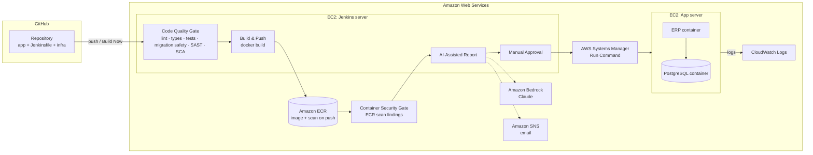

# OneClick ERP: Deployment Guide

This guide covers **what** you are deploying, **why** each piece exists, and **how** to get from an empty AWS account to a production release you trigger with one click.

> **The short version**
> 1. Run `scripts/provision.ps1` (or `.sh`) **once**. Terraform creates all the AWS infrastructure and a Jenkins server that is already configured.
> 2. After that, each release is **one click**: Jenkins → `oneclick-erp` → **Build Now** (or a `git push`).
> 3. The pipeline runs the code-quality gate, builds the image, scans it, writes an AI summary, waits for a named approver, deploys to EC2, checks that the app is healthy, and rolls back on its own if it isn't.

---

## Contents

1. [What you are building](#1-what-you-are-building)
2. [How this maps to the OneClick CI/CD document](#2-how-this-maps-to-the-oneclick-cicd-document)
3. [Repository layout](#3-repository-layout)
4. [Prerequisites (one time)](#4-prerequisites-one-time)
5. [Step-by-step: first deployment](#5-step-by-step-first-deployment)
6. [The one click: what happens inside the pipeline](#6-the-one-click-what-happens-inside-the-pipeline)
7. [Day-2 operations](#7-day-2-operations)
8. [Troubleshooting](#8-troubleshooting)
9. [Security design](#9-security-design)
10. [Cost](#10-cost)
11. [Tear down](#11-tear-down)
12. [Growing up: path to ECS Fargate and RDS](#12-growing-up-path-to-ecs-fargate-and-rds)

---

## 1. What you are building

### The application: a deliberately small ERP

| Module | What it does |
|---|---|
| **Dashboard** | Product, customer and open-order counts, revenue, low-stock alerts |
| **Products & Stock** | Create, edit and delete products; receive stock; reorder levels |
| **Customers** | Create and delete customers |
| **Sales Orders** | Create an order. In one transaction it checks stock, locks the rows, decrements inventory and stores the order. Orders move NEW → CONFIRMED → SHIPPED. Cancelling an order puts its stock back. |

**Stack:** Node.js 22 + Express 5, PostgreSQL 16, and plain HTML/JS for the UI (no frontend build step). The schema is applied by versioned SQL migrations every time the app starts.

The app is kept small on purpose. The point of this project is the **delivery pipeline**, and the app only needs enough real behavior (a database, transactions, migrations) to make every gate meaningful.

### The platform



| Component | AWS service | Why it is here |
|---|---|---|
| Source of truth | **GitHub** | Holds the app, the pipeline (`Jenkinsfile`) and the infrastructure (Terraform). Everything is versioned. |
| CI/CD engine | **Jenkins on EC2** (`t3.medium`) | Runs the pipeline. It boots fully configured through *Configuration-as-Code*, so there is no setup wizard and no clicking through plugin screens. |
| Image registry | **Amazon ECR** | Stores every release image under an immutable tag (`<build>-<commit>`). It also scans each image on push, and that scan is the container gate. |
| AI report | **Amazon Bedrock** (Claude) | Turns about ten raw check logs into a short summary the approver can actually read. |
| Notifications | **Amazon SNS** | Emails the report, the approval request and the result. |
| Deployment channel | **AWS Systems Manager (SSM)** | Jenkins tells the app server to deploy without SSH keys or open SSH ports, and every command is logged. |
| Runtime | **EC2 app server** (`t3.small`) + Docker Compose | Runs the ERP container and PostgreSQL. This is the simplest production-like setup: one VM and two containers. |
| Logs | **CloudWatch Logs** | App logs, database logs and deploy output, all in one log group. |
| Secrets | **SSM Parameter Store** (SecureString) | Jenkins passwords, the DB password and the GitHub token. Terraform generates them and none of them are stored in Git. |

---

## 2. How this maps to the OneClick CI/CD document

The PDF shows Azure Repos plus an Azure code-quality gate, then ECR, a container gate, an AI report, manual approval, ECS Fargate and CloudWatch. This project keeps **the same flow and the same guarantees**, with three substitutions you asked for or that keep things simple:

| PDF box | This project | Change and reason |
|---|---|---|
| Azure Repos | **GitHub** | You asked to use GitHub instead of Azure Repos. |
| Code Quality Gate (Lint · Type Check · Tests · Migration Safety · SAST/SCA) | Jenkins phase 2: **ESLint · `tsc` type check · unit tests · migration-safety script · ESLint-security (SAST) · `npm audit` (SCA)**, plus optional **SonarQube** | Same checks. They now run in Jenkins on AWS instead of Azure Pipelines. |
| Build & Push (Docker build → image) | Jenkins phase 3 | Same. |
| Amazon ECR | Amazon ECR | Same. |
| Container Security Gate ("Snyk scan + gate") | **Amazon ECR image scanning** + a gate that fails on CRITICAL/HIGH | AWS-native: no extra vendor account or licence. Snyk or Trivy can be added later as one more stage. |
| AI-Assisted Report (summary + notify) | **Claude on Amazon Bedrock** + **SNS email** | Same purpose. It never blocks a release: if the AI call fails, a rule-based report is sent instead. |
| Manual Approval (leader sign-off) | Jenkins `input` step restricted to **named approver users** | Same. The approver's name is recorded in the build. |
| ECS Fargate (deploy app + update) | **EC2 + Docker Compose**, deployed through **SSM** | You asked for EC2. It is simpler to understand and debug. [Section 12](#12-growing-up-path-to-ecs-fargate-and-rds) shows how to move to Fargate. |
| CloudWatch Logs | CloudWatch Logs | Same. |

**"Eleven automated checks in six phases"** in this project:

| Phase | # | Check | Blocks release? |
|---|---|---|---|
| 1. Source | - | Checkout + compute immutable image tag | - |
| 2. Code Quality Gate | 1 | Lint (ESLint) | Yes |
| | 2 | Type check (TypeScript `checkJs`) | Yes |
| | 3 | Unit tests (25 tests: validation, order/stock logic, API, migration rules) | Yes |
| | 4 | Migration safety (blocks DROP/TRUNCATE/RENAME/type changes and edits to applied migrations) | Yes |
| | 5 | SAST (eslint-plugin-security) | Yes |
| | 6 | SCA (`npm audit`, high and above) | Yes |
| | 7 | SonarQube quality gate (*optional*, runs when configured) | Yes |
| 3. Build & Push | 8 | Docker build (multi-stage, non-root, no npm in the runtime image) + push to ECR | Yes |
| 4. Container Security Gate | 9 | ECR vulnerability scan; fails on CRITICAL/HIGH | Yes |
| 5. Report & Approval | - | AI-assisted report → email | No (informational) |
| | - | **Manual approval by a named approver** | Yes (human) |
| 6. Deploy & Verify | 10 | Deploy health check on the server, **auto-rollback** if unhealthy | Yes |
| | 11 | External smoke test: `/health` must report the **new version** | Yes |

---

## 3. Repository layout

```
oneclick-erp/
├── Jenkinsfile                     # The pipeline: all six phases
├── docker-compose.yml              # Local development (app + Postgres)
├── app/                            # The ERP application
│   ├── src/                        #   Express API, order/stock service, migrations runner
│   ├── migrations/                 #   Versioned SQL (001_init.sql, 002_seed_demo_data.sql)
│   ├── public/                     #   Web UI (plain HTML/CSS/JS)
│   ├── test/                       #   Unit + API tests (node:test, no DB needed)
│   ├── scripts/check-migrations.js #   Migration-safety gate
│   ├── eslint.config.js            #   Lint rules
│   ├── eslint.security.config.js   #   SAST rules
│   └── Dockerfile                  #   Production image
├── ci/ai-report/                   # AI-assisted release report (Claude on Bedrock)
├── jenkins/                        # Pre-configured Jenkins image
│   ├── Dockerfile                  #   Jenkins + Docker CLI + Node 22 + AWS CLI
│   ├── plugins.txt                 #   Plugins baked into the image
│   └── jenkins.yaml                #   Configuration-as-Code: users, env, credentials, job
├── infra/terraform/                # All AWS infrastructure
│   ├── main.tf                     #   VPC lookup, AMI, security groups
│   ├── ec2.tf                      #   Jenkins + app servers, Elastic IPs
│   ├── iam.tf                      #   Least-privilege roles
│   ├── ecr_logs_sns.tf             #   ECR, CloudWatch log group, SNS topic
│   ├── secrets.tf                  #   Generated passwords in SSM Parameter Store
│   ├── templates/                  #   First-boot scripts (user data)
│   └── files/                      #   docker-compose.prod.yml + deploy.sh for the app server
├── scripts/provision.ps1 / .sh     # One-time setup in one command
└── docs/DEPLOYMENT_GUIDE.md        # This file
```

---

## 4. Prerequisites (one time)

### 4.1 Accounts

- **An AWS account** with permission to create EC2, IAM, ECR, SNS, SSM and CloudWatch resources. An admin user is fine for a first run.
- **A GitHub account.**

### 4.2 Tools on your computer

| Tool | Check | Install |
|---|---|---|
| Git | `git --version` | https://git-scm.com |
| Terraform ≥ 1.6 | `terraform -version` | https://developer.hashicorp.com/terraform/install |
| AWS CLI v2 | `aws --version` | https://aws.amazon.com/cli/ |
| Node.js 22+ *(only for running tests locally)* | `node -v` | https://nodejs.org |
| Docker Desktop *(only for running locally)* | `docker version` | https://www.docker.com |

### 4.3 Log the AWS CLI in

```powershell
aws configure            # paste an access key + secret, choose your region (e.g. us-east-1)
aws sts get-caller-identity   # must print your account ID
```

### 4.4 Enable Claude on Amazon Bedrock (for the AI report)

1. AWS Console → **Amazon Bedrock** → **Model access** in the same region you deploy to.
2. Request or enable access to **Anthropic Claude** (the pipeline defaults to `anthropic.claude-opus-5-5`).
3. Pick a region where that model is offered. To use a different Claude model, set `bedrock_model_id` in `terraform.tfvars`.

> If you skip this step, nothing breaks: the report step catches the error and emails a rule-based summary instead.

---

## 5. Step-by-step: first deployment

### Step 1: Put the project on GitHub

```powershell
cd D:\oneclick-erp
git init -b main
git add .
git commit -m "OneClick ERP: app, pipeline and infrastructure"
# Create an empty repo on github.com named oneclick-erp (no README), then:
git remote add origin https://github.com/<your-user>/oneclick-erp.git
git push -u origin main
```

**Private repo?** Create a *fine-grained personal access token* with **Contents: Read-only** on this repo. You will paste it into `terraform.tfvars` in the next step. A public repo needs no token.

### Step 2: Fill in your settings

```powershell
cd infra\terraform
copy terraform.tfvars.example terraform.tfvars
notepad terraform.tfvars
```

| Variable | What to put | Why |
|---|---|---|
| `aws_region` | e.g. `us-east-1` | Must be a region where Bedrock Claude is enabled (see 4.4). |
| `github_repo_url` | `https://github.com/<you>/oneclick-erp.git` | The repo Jenkins builds from. |
| `admin_cidr` | your IP + `/32` (get it from `curl https://checkip.amazonaws.com`) | **Only you** can open the Jenkins UI. |
| `notification_email` | your email | Receives reports, approval requests and results. |
| `github_token` | only for private repos | Read-only clone access. |
| `github_webhook_cidrs` | optional (see the comment in the file) | Lets a `git push` trigger the pipeline. |

`terraform.tfvars` is git-ignored, so your settings never reach GitHub.

### Step 3: Provision everything (one command, run once)

```powershell
cd D:\oneclick-erp
.\scripts\provision.ps1          # Windows
# ./scripts/provision.sh         # macOS / Linux / Git Bash
```

Terraform shows a plan of about 30 resources. Type `yes`. The script then:

1. Creates the security groups, IAM roles, ECR repository, CloudWatch log group, SNS topic, secrets, both EC2 servers and their Elastic IPs (about 2 minutes).
2. Waits while the **Jenkins server builds its own pre-configured image** on first boot (about 5 to 8 minutes).
3. Prints your URLs and passwords:

```
 Jenkins     : http://54.x.x.x:8080/
   admin     : admin    / <generated>
   approver  : approver / <generated>
 App URL     : http://3.x.x.x
```

You can print the passwords again at any time with `terraform output -raw jenkins_admin_password`.

### Step 4: Confirm the email subscription

AWS SNS sends a **"Subscription Confirmation"** email to `notification_email`. Click **Confirm subscription**. Until you do, no notifications are delivered.

### Step 5: The one click

1. Open the Jenkins URL and log in as **admin**.
2. Click the **`oneclick-erp`** job, which Configuration-as-Code already created.
3. Click **Build Now**.

Watch the stage view as the pipeline moves through each phase. When it reaches **5b. Manual Approval**:

4. You receive an email with the AI release report and a link.
5. Log in as **approver** (by design, only users in `release_approvers` can approve) and click **Approve & Deploy**.
6. The pipeline deploys, verifies, and emails you that the build is **Deployed**.

Open the **App URL**. Your ERP is live, with demo data loaded.

### Step 6 (optional): Deploy on every push

1. Set `github_webhook_cidrs` in `terraform.tfvars` (GitHub's "hooks" ranges from https://api.github.com/meta) and re-run `provision`.
2. GitHub repo → **Settings → Webhooks → Add webhook**:
   - Payload URL: the `github_webhook_url` output (`http://<jenkins-ip>:8080/github-webhook/`)
   - Content type: `application/json`, event: **Just the push event**
3. Jenkins only learns which repo to watch after the job has **run once**. Step 5 already did that.

From now on, `git push` to `main` starts the pipeline, and it still stops for the human approval before anything reaches production.

---

## 6. The one click: what happens inside the pipeline

Each stage is defined in the [`Jenkinsfile`](../Jenkinsfile). Every check writes its output to `reports/`. Jenkins archives that folder with the build and the AI report reads it.

### Phase 1: Source
`checkout scm` from GitHub. The image tag is set to `<build-number>-<commit-sha>`, for example `14-a1b2c3d4`. ECR tags are **immutable**, so a tag always points to exactly one image. That gives you a clean audit trail.

### Phase 2: Code Quality Gate (checks 1 to 7)

| Check | Command | What it catches |
|---|---|---|
| Lint | `npm run lint` | Bugs and dead code (ESLint recommended rules) |
| Type check | `npm run typecheck` | Type errors in JavaScript via TypeScript `checkJs` + JSDoc |
| Unit tests | `npm test` | Validation, stock/oversell logic, cancellations, API status codes, migration rules. They use a fake DB, so they run in seconds with no database. |
| Migration safety | `npm run migrations:check` | Blocks `DROP TABLE/COLUMN`, `TRUNCATE`, `DELETE` without `WHERE`, column type changes and renames, plus **edits to migrations that were already deployed**. To allow an intended destructive change, add `-- migration-safety: allow-destructive <reason>` to the file. The reason then shows up in code review. |
| SAST | `npm run sast` | Insecure code patterns: `eval`, non-literal `require`/`fs` paths, unsafe regex, child processes |
| SCA | `npm run sca` | Known-vulnerable dependencies (`npm audit`, high and above) |
| SonarQube *(optional)* | `@sonar/scan` with `qualitygate.wait=true` | Your organization's Sonar quality gate. Runs only when `SONAR_HOST_URL` is set (see [7.5](#75-turn-on-sonarqube-optional)). |

You can run any of these on your own machine before pushing:

```powershell
cd app
npm ci
npm run lint; npm run typecheck; npm test; npm run migrations:check; npm run sast; npm run sca
```

### Phase 3: Build & Push (check 8)
A multi-stage Docker build produces a small Alpine image. It runs as the non-root `node` user. **npm and yarn are removed** from the runtime image, which takes away a common source of container CVEs. The image is pushed to ECR.

### Phase 4: Container Security Gate (check 9)
ECR scans the image on push. The pipeline waits for the scan, saves the findings to `reports/ecr-scan.json`, and **fails the build if there is any finding at the severities in `FAIL_ON_SEVERITY`** (default `CRITICAL,HIGH`). To make it stricter, set `fail_on_severity = "CRITICAL,HIGH,MEDIUM"`.

### Phase 5: AI-Assisted Report + Manual Approval
- [`ci/ai-report/report.mjs`](../ci/ai-report/report.mjs) sends every check's output to **Claude on Amazon Bedrock**. It authenticates with the Jenkins server's IAM role, so there is no API key. Claude writes a summary of about 250 words: what is shipping, the result of each gate, security findings, and risks to review.
- The summary is emailed through SNS together with the approval link, and archived with the build.
- **It never blocks a release.** If Bedrock is unavailable, model access isn't enabled, or the model declines, a rule-based report is sent instead.
- **Manual approval**: the pipeline pauses for up to 24 hours. Only users listed in `release_approvers` can click **Approve & Deploy**, and Jenkins records who approved. If nobody approves within 24 hours, the build aborts and nothing is deployed.

### Phase 6: Deploy & Verify (checks 10 and 11)
1. Jenkins calls **SSM Run Command** on the app server: `/opt/erp/deploy.sh <image>`. There is no SSH, and the command output is also copied to CloudWatch.
2. [`deploy.sh`](../infra/terraform/files/deploy.sh) logs in to ECR, pulls the image and restarts the app container. Postgres keeps running and the data volume is untouched. Then it **polls `/health` for up to 2.5 minutes**.
3. **If the new version is unhealthy, it rolls back automatically** to the previous image and the build fails.
4. The external smoke test calls `http://<app>/health` from Jenkins and requires `status: ok` and `version: <this release's tag>`, which proves the new code is the code serving traffic.
5. A **Deployed** email is sent with links to the app, the logs and the build.

On startup the app applies any new SQL migrations, each in its own transaction, before it accepts traffic.

---

## 7. Day-2 operations

### 7.1 Make a change and release it
```powershell
# edit code, e.g. app/src/routes/api.js
cd app; npm test            # optional local check
git commit -am "Add X"; git push
```
Then click **Build Now**, or let the webhook start it. Approve, and the change is live.

### 7.2 Add a database change
Create the next numbered file, for example `app/migrations/003_add_customer_notes.sql`:
```sql
ALTER TABLE customers ADD COLUMN IF NOT EXISTS notes TEXT;
```
**Never edit a migration that is already deployed.** The migration-safety gate fails the build if you do. Prefer additive changes. To drop a column safely: stop using it in one release, then drop it in a later release with the `allow-destructive` marker.

### 7.3 Roll back
- **Automatic:** a failed health check rolls back on its own.
- **Manual (recommended):** `git revert <bad-commit>` + push, then click **Build Now**. The fix goes through every gate like any other release.
- **Emergency (skips the gates):** redeploy an older image that is already in ECR:
  `aws ssm send-command --instance-ids <app_instance_id> --document-name AWS-RunShellScript --parameters 'commands=["/opt/erp/deploy.sh <ecr-url>:<older-tag>"]'`

### 7.4 Logs
- **CloudWatch** → Log groups → `/oneclick-erp/app` (the `cloudwatch_logs_url` output links straight to it).
  - `app/<container-id>`: application JSON logs
  - `postgres`: database logs
  - SSM deploy output streams
- Logs Insights query for errors:
  ```
  fields @timestamp, msg, error | filter level = "error" | sort @timestamp desc
  ```
- A shell on a server, without SSH: EC2 → instance → **Connect → Session Manager**.

### 7.5 Turn on SonarQube (optional)
1. In Jenkins: **Manage Jenkins → Credentials →** update `sonar-token` with your Sonar token.
2. Add `SONAR_HOST_URL=https://your-sonar` to `/opt/jenkins/jenkins.env` on the Jenkins server, then run `docker restart jenkins`. To make it permanent, add it to the template in `infra/terraform/templates/jenkins-user-data.sh.tftpl`.
3. The next build runs the SonarQube stage and waits for the quality gate.

### 7.6 Add more approvers
Create users in Jenkins (**Manage Jenkins → Users**). Then set `release_approvers = "approver,alice,bob"` in `terraform.tfvars` and re-run `provision`.

> Changing Jenkins config through Terraform **recreates the Jenkins server** (user data changed). Build history is lost, but the app server and its data are not affected.

### 7.7 Back up the database
For a quick manual backup, open Session Manager on the app server and run:
```bash
cd /opt/erp && docker compose exec -T db pg_dump -U erp erp | gzip > /root/erp-$(date +%F).sql.gz
```
For real production, move to Amazon RDS ([section 12](#12-growing-up-path-to-ecs-fargate-and-rds)), which gives you automated backups and point-in-time restore.

---

## 8. Troubleshooting

| Symptom | Likely cause | Fix |
|---|---|---|
| Jenkins URL does not load | First boot is still running, or your IP changed | Wait about 8 minutes. Check that `admin_cidr` matches `curl https://checkip.amazonaws.com`. To see progress: Session Manager on the Jenkins instance, then `sudo tail -f /var/log/cloud-init-output.log`. |
| No `oneclick-erp` job | The Configuration-as-Code job failed | `sudo docker logs jenkins` on the Jenkins server and search for `job-dsl` or `casc`. |
| Checkout fails: authentication | Private repo with no token, or a wrong token | Set `github_token` and re-run `provision`. |
| `docker: permission denied` in a build | Docker socket group mismatch | `sudo docker restart jenkins`. The `--group-add` is set when the container starts. |
| `Container gate FAILED` | The image has CRITICAL/HIGH CVEs | Read the findings in the console. Usually a newer base image fixes it: rebuild (the build uses `--pull`). Or update the dependency named in the findings. |
| `npm audit` fails (SCA) | A vulnerable dependency | `cd app; npm audit fix`, run the tests, commit. |
| AI report says "Automatic summary unavailable" | Bedrock model access is not enabled in this region, or the model ID is wrong | See [4.4](#44-enable-claude-on-amazon-bedrock-for-the-ai-report). The release still proceeds. |
| No emails | SNS subscription not confirmed | Confirm the AWS email. Check spam. |
| Approve button missing | You are logged in as a user not in `release_approvers` | Log in as `approver`. |
| Deploy fails, `DEPLOY FAILED ... ROLLING BACK` | The app crashed on start (often a migration error) | CloudWatch → `app/...` stream for the stack trace. Fix and redeploy. The previous version is already serving again. |
| Smoke test fails but deploy passed | The app port is blocked from Jenkins | Check the app security group allows port 80. |

---

## 9. Security design

- **No SSH anywhere.** Both servers are managed through SSM Session Manager and Run Command, and port 22 is never opened.
- **Least-privilege IAM.** Jenkins can push to **one** ECR repo, send commands to **one** instance, publish to **one** SNS topic and read **its own** secrets. The app server can pull images, write to **its** log group and read **its** DB password.
- **Secrets** are generated by Terraform and stored as SSM SecureStrings. They are never in Git, never in the image, and never in the pipeline log.
- **Jenkins UI** is reachable only from `admin_cidr` (and the GitHub webhook ranges if you enable them). Anonymous access is off and sign-up is disabled.
- **Postgres is not exposed.** It only listens on the private Docker network on the app server.
- **IMDSv2 required** and **encrypted EBS volumes** on both instances.
- **Immutable image tags** in ECR. The same tag can never be overwritten.
- **App hardening:** non-root container, security headers, body size limit, parameterized SQL everywhere, and generic 500 errors that don't leak internals.
- **Known simplifications for a demo** (fix these before real production): HTTP rather than HTTPS (add an ALB with an ACM certificate, or CloudFront); the Terraform state file contains the generated passwords (use the S3 backend in `versions.tf`, encrypted and access-controlled); builds run on the Jenkins controller (add a separate build agent for isolation).

---

## 10. Cost

Rough on-demand prices in `us-east-1`, running 24/7:

| Item | ≈ per month |
|---|---|
| Jenkins EC2 `t3.medium` | $30 |
| App EC2 `t3.small` | $15 |
| EBS gp3 (30 + 20 GB) | $4 |
| 2 public IPv4 addresses (Elastic IPs) | $7 |
| ECR, CloudWatch Logs, SNS, SSM | $1-3 |
| Bedrock (one short report per build) | cents per build |
| **Total** | **about $57-60** |

To save money, **stop the Jenkins instance** when you are not releasing (EC2 → Stop, then Start before a release; the Elastic IP keeps the URL). Or run `provision destroy` when you are done.

---

## 11. Tear down

```powershell
.\scripts\provision.ps1 destroy
```
This deletes **everything**, including the ECR images and the database on the app server. Back up first if you need the data.

---

## 12. Growing up: path to ECS Fargate and RDS

This project uses EC2 because it is the simplest setup to learn and debug. The pipeline is built so that moving to the PDF's ECS Fargate target **only changes phase 6**:

| Step | Change |
|---|---|
| 1. Database | Replace the Postgres container with **Amazon RDS for PostgreSQL** (Multi-AZ, automated backups). Put the URL in SSM and pass it as `DATABASE_URL`. |
| 2. Runtime | Add Terraform for an **ECS cluster + Fargate service + Application Load Balancer** (HTTPS with ACM). The task definition uses the same image and the `awslogs` driver to the same CloudWatch group. |
| 3. Deploy stage | Replace the SSM command with: register a new task definition revision with the new image, `aws ecs update-service --force-new-deployment`, then `aws ecs wait services-stable`. ECS rolling deployments with the **deployment circuit breaker** replace `deploy.sh`'s rollback. |
| 4. Everything else | Phases 1 to 5 (quality gate, ECR, container gate, AI report, approval) stay **unchanged**. |

The PDF's rollout requirements map to this project as follows:

| Rollout requirement (PDF) | Here |
|---|---|
| AWS and SonarQube service connections configured once | IAM instance role (AWS, no keys) + the `sonar-token` credential, all created by Terraform and Configuration-as-Code |
| A named approver group for the release-approval gate | `release_approvers` variable → Jenkins `input` `submitter` |
| ECR repository, compute, CloudWatch log group provisioned in AWS | `infra/terraform` (EC2 now, ECS later) |
| Pipeline template rolled out to each repository | Copy `Jenkinsfile` + `ci/` into another repo and add one more `pipelineJob` block to `jenkins/jenkins.yaml`, or move the shared stages into a Jenkins Shared Library |
